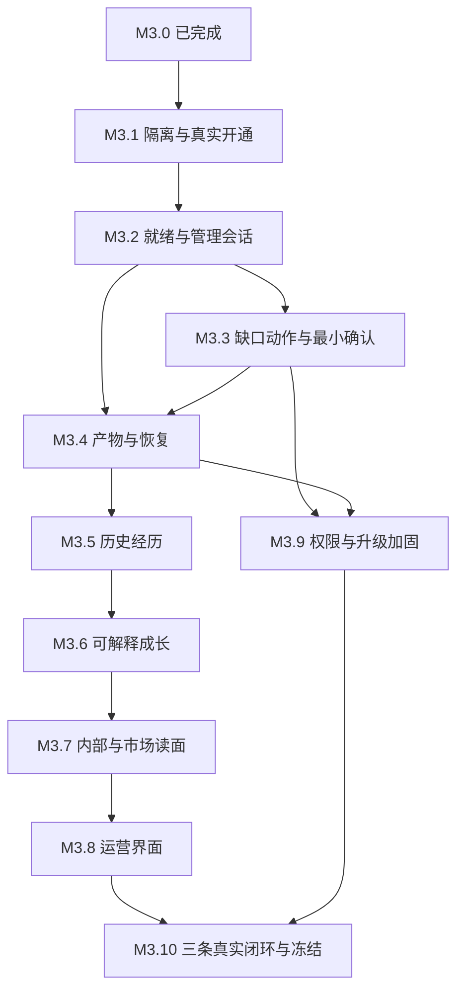
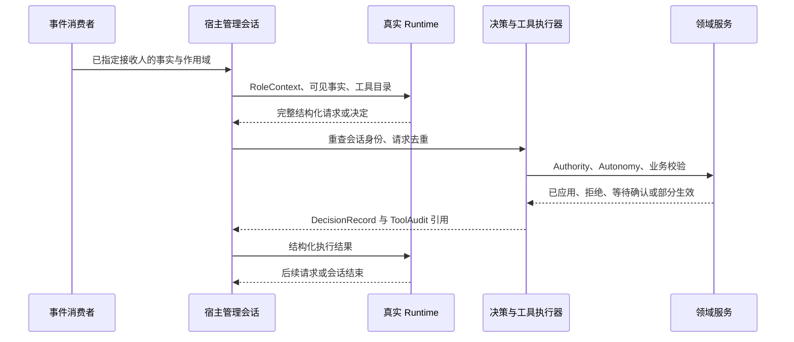
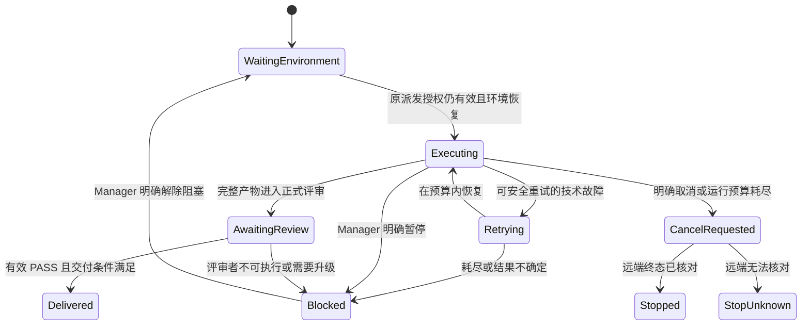
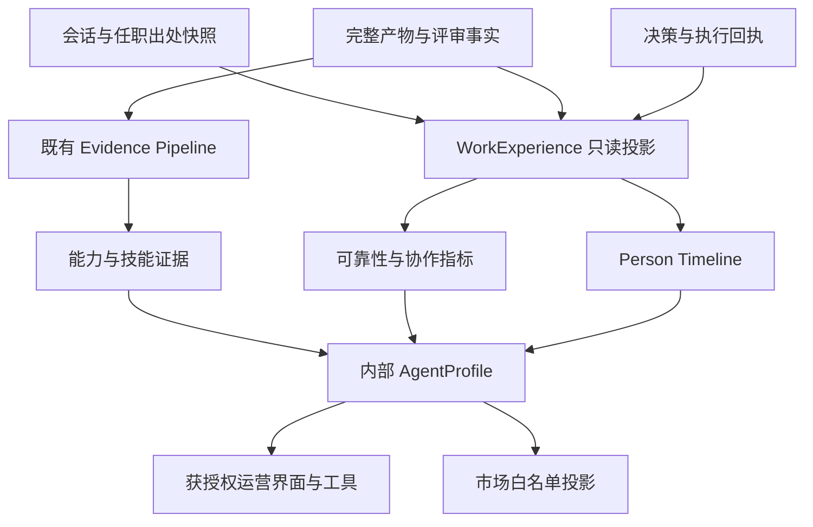
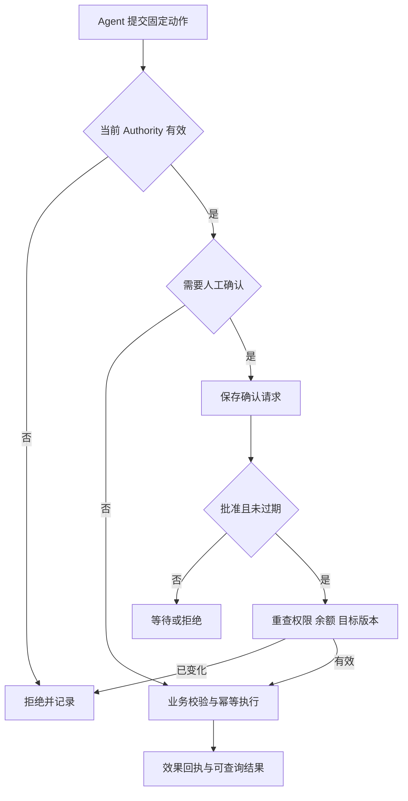

# M3 Agent Production and Growth - Plan

> **执行基线**：本文（`docs/m3-implementation-plan.md`）。
> **设计**：`docs/m3-agent-production-growth-design.md`（M3.0 冻结）。
> **前置冻结面**：M2（`docs/m2-freeze.md`，105/105 enforced）、M1、T2、T1、R1。
> **代码化契约**：`apps/server/app/work/production.py` + `apps/server/tests/test_m3_contract.py`。

**最高原则（不重新谈判）**：

```text
System provides facts.   Agent makes decisions.
System validates.        System executes.        System records.
```

**M3 的边界一句话**：M2 负责"公司怎么组织工作"；M3 负责"Agent 怎么真正工作，并因为工作而成长"。

---

## Goal Capsule

- **Objective**：玩家能让真实 AI 团队完成一个软件项目，在故障后继续推进，并从可追溯的交付事实中查看每个人才的经历与成长。
- **Means**：沿用 M3.0–M3.10，执行下文 U1–U31；复用现有 Runtime、任务图、决策、评审、证据与经济服务。
- **Authority**：用户要求优先；产品语义以 M3 设计及 P1–P36 为准；本文规定实施顺序。涉及 M2 冻结面时，先登记兼容增补和守卫变化，再实施。
- **Execution profile**：每个工作包独立实现、验证、提交。先完成真实执行的小闭环，再扩展成长读面；真实调用需要隔离环境、显式开关和预算上限。
- **Stop conditions**：真实环境缺失则记录阻塞，不以 mock 补签真实验收；权限、身份、费用或历史归属无法确定时不执行有副作用动作。
- **Delivery boundary**：本次交付详细规划。后续实施按工作包推进；提交、推送和发布范围由届时任务授权决定。

---

## Product Contract

### Summary

M3 将已有组织与协作流程接到真实执行环境，贯通管理决策、执行、评审、交付和成长。
阶段编号与产品范围保持不变；本次补齐真实工具桥、管理唤醒、审批、历史采集和故障恢复的实施依赖。

### Problem Frame

现有适配器、领域服务和内部工具分别存在，但真实 Runtime 尚未贯通管理工具调用与结果回传。
实例行存在不足以证明员工可工作，模型退出不足以证明交付完成，当前职位也不能解释过去的贡献。
这些接缝需要在真实交付前处理，否则后续履历和市场只能展示缺失或失真的事实。

### Requirements

**真实工作与控制：**

- R1. 员工入职后可幂等开通真实环境，并获得有时间和原因的就绪结论。对应 §4–§5、P4–P8、P13、P31–P32。
- R2. Manager 与 Reviewer 可通过真实会话读事实、提交决定并获取执行结果，身份与权限始终由系统校验。对应 §5–§6、P10、P28–P30。
- R3. 七类能力缺口动作具有真实可调用入口，高影响动作必须经有效确认。对应 §6、§12、P9–P13、P30、P33。
- R4. 技术重试、取消与崩溃恢复保留可核对的执行事实，业务任务不会因重复或晚到结果被错误推进。对应 §7、P14–P17、P29、P35。

**交付与成长：**

- R5. 产物通过完整性、会话归属和评审后才能交接及交付。对应 §7、§13、P17–P18。
- R6. 工作经历归属于当时的 Person，并保留组织、任务、环境的历史快照。对应 §8、P2、P14、P18、P23。
- R7. 可靠性、专精、协作和管理履历来自可解释事实，数据不足明确显示未知。对应 §9、P19–P22。
- R8. 内部 AgentProfile、Agent 工具、运营界面共用读面，市场仅消费获准公开的投影。对应 §10–§11、P1、P26–P27。

**验收与既有边界：**

- R9. Authority、Autonomy、升级路由及换绑具有完整的拒绝、等待与恢复路径。对应 §12、P14、P23、P30。
- R10. 三条真实调用链分别证明交付、招聘后工作和故障恢复，mock 与真实证据分别记录。对应 §13–§14、P24–P25。
- R11. 阶段完成有可重现测试、迁移和冻结锚点证据；随机序隔离债务先于新增真实执行行为处理。对应 §2、§14。

### Assumptions

沿用既有 Hermes / OpenClaw 范围和本地部署形态；不引入新 Runtime、公共多人世界或通用策略引擎。
用户尚未补完的重点不推断为新需求；如补充改变范围，先修订对应要求和依赖。
不承诺日历工期：真实协议接入和恢复验证的工作量在 M3.1–M3.2 的实测后再估算。

### Baseline

截至 `7ab5644`，M3.0 已由 `6f4e97b` 完成。
最近六个修复提交覆盖公司隔离、会话收尾、订单交付、返工约束、事件退出、教程并发、WebSocket 清理及读面性能；它们作为回归基线，不重复列为待办。
最近验收为后端 1396 passed、6 Docker 集成测试 deselected，前端 390 passed，lint 与 build 通过。
本次规划只读代码，不重新运行上述测试；历史随机序 6 次 5 红仍未有关闭证据。

**Product Contract preservation**：保留既有 M3 产品范围、阶段编号和 P1–P36；调整实现依赖，将最小审批、执行历史采集和真实管理接入放到首次使用之前。

---

## 1. M3 总览

### 1.1 M3 做

```text
真实 Runtime 拉起（Hermes / OpenClaw）与健康/能力探测
AgentReadiness（派生就绪事实，四层，不新增 bool/表）
Capability Gap 的七类动作工具化（学习 / 选择内部员工 / 改派已有任务 / 招聘 / 改方案 / 拆任务 / 委派）
执行遥测（结构化事件）、技术重试与管理 replan 分离、崩溃对账
Work Experience（履历投影）与 Unified Person Timeline
可靠性指标 / 专精 / 协作事实 / 管理履历（全部派生、可解释）
AgentProfile（读模型）与市场投影复用
Agent Operations UX（结构化活动，不暴露 chain-of-thought）
Authority / Autonomy / ESCALATE / Rebinding 在 M1 面的收口
真实 Runtime Golden Path × 3 + M3 冻结
```

### 1.2 M3 不做（写进设计 §21）

```text
公司股权/融资/公司交易/贷款/分红/并购/多币种/复杂仲裁
公开多人服务器 / 真正世界宏观经济
新的中央 Planner / 系统自动 Team Formation / 自动招聘 / 自动辞退
完整 Agent 社交系统
Codex / Claude Code / OpenCode / Custom 新 Runtime（保持 placeholder）
```

### 1.3 阶段表

| 阶段 | 主题 | 迁移 | 状态 |
| --- | --- | --- | --- |
| M3.0 | Production Agent Contract Freeze | 零 | **DONE**（`6f4e97b`） |
| M3.1 | Real Runtime Provisioning | 开通归属、出处快照按需 | IN_PROGRESS |
| M3.2 | Ready-to-Work & Runtime Readiness | 管理会话 / 调用幂等按需 | PLANNED |
| M3.3 | Capability Gap Actions | 动作确认记录按需 | PLANNED |
| M3.4 | Execution Telemetry & Recovery | 遥测 / 恢复元数据按需 | PLANNED |
| M3.5 | Work Experience & Unified Resume | 视裁决 | PLANNED |
| M3.6 | Reliability / Specialization / Collaboration | 无 | PLANNED |
| M3.7 | Agent Asset Read Model | 无 | PLANNED |
| M3.8 | Agent Operations UX | 无 | PLANNED |
| M3.9 | Authority / Escalation / Binding Hardening | 视需要 | PLANNED |
| M3.10 | Real Runtime Golden Path & Freeze | 无 | PLANNED |

---

## 2. 横切要求（每个阶段都要过）

1. **不变量先行**：新概念先在 `app/work/production.py` 冻契约（含锚点与反例注入），再写实现。
2. **门禁全绿**：`pytest`（固定序）/ `ruff check` / `ruff format --check` / `alembic check` /
   前端 `tsc` / `eslint` / `prettier` / `vitest` / `build`（碰前端才跑）。
3. **反例注入验证**：每个新守卫必须"注入违规 → 转红 → 撤回 → 转绿"，禁止声明式装饰。
4. **冻结锚点回归**：
   - 碰 Project / Task / Decision / Tool Executor / DAG / Review / Handoff / WorkOrder bridge
     ⇒ 先跑 M2 freeze anchors；
   - 碰 Recruitment / Talent Market / Contract / Escrow / Settlement
     ⇒ 先跑 T2 / M1 锚点。
5. **唯一写入路径**：新表/新列必须能回答"谁写、谁读、为什么不是别处"；同一事实不留两个落点。
6. **迁移纪律**：additive first；`up → down → up`；`alembic check` 无漂移；不为"未来可能要的表"建表。
7. **真实 Runtime 安全**（M3.1 起）：
   - 真实 Runtime **不是默认可信**：Container / Workspace / Tool 权限由系统控制；
   - Runtime **不能伪造 actor identity**，**不能自行声明 Authority**；
   - Tool Executor 继续走 M2 Authority 边界；
   - **Provider Secret 不得暴露给 Agent**（只进 Runtime 环境，不进 prompt/产物/审计）。
8. **Git 纪律**：动手前核对状态和历史；保留 `tmp/`、历史未跟踪文件及与任务无关的用户改动。
   每个 U 工作包独立 commit，不将整个 M3 或多个无关阶段揉成一次提交；阶段收尾同步验收证据。
9. **文档同步**：阶段收尾更新本文 §16 Progress + `docs/handover.md` + 设计文档不变量表。
10. **测试隔离**（技术债 1）：M3.1 之前先修套件级 per-test 隔离（真随机序当前 6 次 5 红）。

---

## 3. M3.0 Production Agent Contract Freeze

### Goal

在进入真实 Runtime 之前，把"什么叫 Agent 可工作、环境事实怎么表达、真实与模拟怎么区分、
履历属于谁、什么事实能变成能力证据"**冻结成契约与守卫**，并让后续每个 M3 阶段都有可回归的锚点。

### 交付物

```text
docs/m3-agent-production-growth-design.md      设计（形态 / 边界 / 36 条不变量 / 12 条 ADR）
docs/m3-implementation-plan.md                 本文（M3.0–M3.10 / 验收 / 风险 / Progress）
apps/server/app/work/production.py             M3 契约层（纯契约，不建表、不发事件、不写业务）
apps/server/tests/test_m3_contract.py          契约 + 守卫测试（P1–P36 的现存锚点）
docs/{architecture,handover}.md                指向 M3 冻结面
```

契约内容（`production.py`）：

| 契约 | 内容 |
| --- | --- |
| 生产阶段 | `ProductionStage`（employment / provisioning / runtime / execution） |
| 就绪映射 | `READINESS_ITEM_STAGE`（item → stage，与 `READINESS_FACT_SOURCES` 双向一致） |
| 编排步骤 | `PROVISIONING_STEP_ORDER` == `READINESS_REQUIRED_FOR_EXECUTION["real"]` |
| 失败原因 | `ProvisioningFailureReason`（8 个可解释原因） |
| 幂等契约 | `IDEMPOTENT_ENSURE_OPERATIONS` + 覆盖场景表 |
| 对账契约 | `RECONCILIATION_ACTIONS`（detect/mark/repair；**无删除**） |
| 真实/模拟 | `execution_mode()` + `EVIDENCE_ENVIRONMENT_*`（与 `evidence.policy` 逐字一致） |
| Provenance | `PROVENANCE_REQUIRED_FIELDS` / `PROVENANCE_PRESENT` / `PROVENANCE_OWED_FIELDS` |
| 能力缺口动作 | `CAPABILITY_GAP_ACTIONS`（7 条，每条 tool 或 owner_stage） |
| 重试语义 | `TECHNICAL_RETRY_OWNER` / `MANAGEMENT_REPLAN_OWNER` + 分属字段 |
| 遥测词表 | `RUNTIME_TELEMETRY_KINDS`（∩ 领域事件 = ∅） |
| 履历契约 | `WORK_EXPERIENCE_FIELDS` + `WORK_EXPERIENCE_SOURCES`（全部真实表列） |
| 资产读模型 | `AGENT_PROFILE_LONG_TERM` / `AGENT_PROFILE_CURRENT_STATE`（两轴分离） |
| 可靠性 | `RELIABILITY_METRICS`（全部带来源，无总战力） |
| Agent SoT 禁区 | `FORBIDDEN_AGENT_SOT_TABLES` |
| 不变量 | `PRODUCTION_INVARIANTS`（P1–P36，全部 enforced） |

### 明确不做（本阶段边界）

```text
✗ 真的启动 Hermes / OpenClaw 容器
✗ 新建 WorkExperience / telemetry 迁移
✗ 重做 UI / 改 Talent Market
✗ 实现全部 capability gap actions
✗ 实现 Authority hardening
✗ 任何 alembic 迁移（零迁移）
```

### Acceptance

| # | 判据 |
| --- | --- |
| A1 | `production.py` 是**纯契约层**：不 import 领域写路径、不建表、不发事件（AST 守卫） |
| A2 | P1–P36 全部 `enforced=True` 且锚点**真实存在**（跨 M3 测试模块解析） |
| A3 | 就绪与 stage 双向一致；就绪项来源可解析到真实表列 |
| A4 | 无 `employee.ready` 列 / 无 `agent_*` 表 / 无 `power` 列（metadata + AST） |
| A5 | mock 判定链与 `evidence.policy` 常量逐字一致 |
| A6 | 遥测词表与 `FACT_EVENTS` / `DECISION_NEEDED_EVENTS` 不重叠 |
| A7 | 每条能力缺口动作都有 tool 或 owner_stage |
| A8 | 欠账（provenance 缺列）显式登记且非空 |
| A9 | 设计文档 ↔ 代码：不变量表逐条一致（文本 + 集合） |
| A10 | 反例注入：每条守卫至少 1 次"注入转红"（本阶段实测） |

### Risks

| # | 风险 | 缓解 |
| --- | --- | --- |
| 1 | 契约层长出"替 Manager 决策"的函数 | 命名守卫（`pick_/choose_/auto_/should_`）+ AST（沿用 M2 A11 同款） |
| 2 | 就绪被写成 bool 第二真相 | metadata 无 `ready` 列 + 派生断言 + 反例注入 |
| 3 | 幽灵工具（词表写了但没人做） | `CAPABILITY_GAP_ACTIONS` 强制 tool 或 owner_stage |
| 4 | 文档漂移 | 设计表 ↔ 代码逐条对拍（M2.10 教训：声明性条数必须机器检） |
| 5 | 新契约模块绕过 M2 冻结面 | P28 + M2 锚点回归 |

---

## 4. M3.1 Real Runtime Provisioning

### Goal

把 `RuntimeInstance row exists` 升级为 `Runtime truly exists and is healthy`：真实支持 Hermes 与
OpenClaw（已有 adapter），补齐健康探测、provider/model 校验、幂等 ensure 与 DB⇄backend 对账。

### 交付物

```text
provisioning 编排加固（work/readiness.orchestrate 的幂等与分步事实）
health / provider / model / capability probe（4 个探测，落在 Reason）
reconciliation service（detect orphan / missing / stale → mark / repair，**不删除**）
provenance 快照列（deployment_mode 等，additive 迁移）
首次真实执行前的 Person / 任职 / 任务要求最小历史快照（U5）
套件级测试隔离（技术债 1）+ 既有 flake 处理（技术债 9）
```

### 明确不做

```text
✗ 新 Runtime 类型（Codex / Claude Code / OpenCode / Custom 继续 placeholder）
✗ 复杂容器编排（K8s / 多机调度）
✗ 自动删除未知容器
```

### Acceptance

| # | 判据 |
| --- | --- |
| B1 | `ensure_runtime_ready(employee)` 幂等：连续 N 次不新增容器/工作区/实例行（P6） |
| B2 | 四类现实场景（行无容器 / 容器无行 / unhealthy / 崩溃后重启）都有确定行为 |
| B3 | 对账输出只有 detect/mark/repair，无删除调用（P7） |
| B4 | 失败原因落在 `ProvisioningFailureReason`（无"未知错误"兜底文案） |
| B5 | 真实 Hermes 与 OpenClaw 各一条集成路径（可跳过：环境门控 + 明确标记 skipped 原因） |

B5 的 skip 只允许环境不具备的开发/CI 检查继续；阶段真实环境验收仍需两种 Runtime 的实际记录。
容器启动、模型调用和业务交付分别出具证据。

### Risks

| # | 风险 | 缓解 |
| --- | --- | --- |
| 1 | CI/本地无 Docker 或镜像缺失 ⇒ 门禁不可重复 | 环境门控 + `detect()` 前置 + 明确 skip 原因，不假装跑过 |
| 2 | 真实模型调用产生费用 | 默认 mock；真实调用需显式开关 + 上限 |
| 3 | 容器/网络资源泄漏 | 幂等 + 对账 + 显式清理入口（人发起） |
| 4 | 启动探测拖慢服务启动 | 探测异步化 + 超时 + 状态回报，不阻塞 lifespan |

---

## 5. M3.2 Ready-to-Work & Runtime Readiness

### Goal

把 §5 的 AgentReadiness 从"契约形状"变成**可查询、可解释、可被派发消费**的就绪读面，
且**不修改 M2 的 Dispatcher 内核**。

### 交付物

```text
AgentReadiness 读面（复用 work/readiness.readiness_report）
派发集成：evaluate_dispatch 之前查就绪 → 不 ready 时发 DECISION_NEEDED（不自动改派）
API + 工具面（readiness / runtime status）补齐解释字段
真实 Runtime ↔ RoleContext / DecisionEnvelope / ToolExecutor 的内部桥（U7）
管理 / 评审事件唤醒、会话用途与独立结束语义（U8）
```

### 明确不做

```text
✗ 改写 M2 dispatcher / DAG 内核
✗ 就绪 ⇒ 自动改派 / 自动换人（P8）
✗ 新增 ready bool 列
```

### Acceptance

| # | 判据 |
| --- | --- |
| C1 | 就绪项覆盖四层；`NOT_READY` 必带原因（P4/P5） |
| C2 | 派发路径只**读**就绪；不 ready ⇒ 事件 + 等待（P8） |
| C3 | mock 与 real 的必答项不同且可解释（P24） |
| C4 | 招募后未完成 provisioning ⇒ 不 READY（P13） |
| C5 | 真实 Manager / Reviewer 收到事实并提交有效决定；不依赖 planning/review fixture |
| C6 | 运行时正常退出但没有有效决定 / verdict，不推进被管理任务 |

### Risks

| # | 风险 | 缓解 |
| --- | --- | --- |
| 1 | 就绪检查变成"先有鸡还是先有蛋"（就绪要求实例，实例要求就绪） | 依赖方向固定：employment → provisioning → runtime → execution |
| 2 | 就绪计算过重（每次派发全量算） | 事实读缓存（读模型层），不落第二真相 |

---

## 6. M3.3 Capability Gap Actions

### Goal

把 Manager 面对能力缺口时的七类动作**完整工具化**：学习、选择内部员工、改派已有任务、招聘、改方案、拆任务、委派。
系统只给事实 + 校验 + 执行 + 记录；**不替 Manager 选**。

### 交付物

```text
读工具：inspect_gap（缺口事实）、search_market / inspect_candidate（市场事实，复用 T2 读面）
写工具：create_learning_priority / request_training（学习事实）、recruit_from_market（经 Authority+Budget）
组合：split_task（create_task + create_dependency 的显式语义）
DecisionRecord 归属：每个动作都过决策信封（署名）
招聘的最小确认通道（提案 / 批准 / 拒绝 / 过期 / 重校验）；M3.9 扩展其覆盖面
```

动作名称沿用设计 §9.2：`learn`、`use_internal_employee`、`reassign`、`recruit`、`revise_task`、`split_task`、`delegate`。
`replan_project` 是 `revise_task` 的已有实现入口之一，不另算一种缺口动作。

### 明确不做

```text
✗ 按阈值自动选动作（P9）
✗ 学习 ⇒ 直接加 competency（P11）
✗ 招聘复制 Person 资产（P12）
✗ 重开 T2 的 Source of Truth（P27）
```

### Acceptance

| # | 判据 |
| --- | --- |
| D1 | 7 条动作全部有工具（或明确 owner_stage），无幽灵词条（P33） |
| D2 | 学习类动作不产生任何 competency 写（AST + 行为）（P11） |
| D3 | 招募动作经 Authority + Budget 校验，且完成后必须过 provisioning（P13） |
| D4 | 市场读面复用 T2 投影，无新决策/定价真相（P27） |

---

## 7. M3.4 Execution Telemetry & Recovery

### Goal

真实执行进入生产后的观测与恢复：结构化遥测、技术重试与管理 replan 分离、崩溃对账。

### 交付物

```text
RUNTIME_TELEMETRY_KINDS 落点（结构化事件；token 流只进日志/短期）
technical retry（有限次 + 退避 + 可解释）与 rework/replan 分离（P15）
启动对账（stuck WorkSession / lost session / partial artifact）
成本与 token 事实（替换 tokens = 0 占位）
真实外部 run 引用、受控产物采集、远端取消与预算停止（U13–U17）
```

### 明确不做

```text
✗ 永久保存全部 token stream
✗ 让 runtime 事件直接改领域状态（P16）
✗ 系统自动 replan（P29）
```

### Acceptance

| # | 判据 |
| --- | --- |
| E1 | 遥测事件不改领域状态（AST + 行为）（P16） |
| E2 | 重试次数与技术重试语义绑定；管理 replan 走 DecisionRecord（P15） |
| E3 | 崩溃后重启不留下永久 `running` 僵尸（对账有明确结果） |
| E4 | 部分写入的产物不进入 handoff |
| E5 | 技术故障会话失败后，非终态任务可进入 blocked，Manager 明确解除阻塞后继续；不强行重开 failed 终态 |
| E6 | 取消和预算耗尽会请求停止对应远端 run，停止未知与已停止分别显示 |
| E7 | 重放、重复终态及迟到用量不重复产生业务作用或扣费 |

---

## 8. M3.5 Work Experience & Unified Resume

### Goal

建立"这个 Person 真正干过什么"的履历投影：来自真实域事实、带历史快照、可查询、可解释。

### 交付物

```text
WorkExperience 读模型（字段契约见设计 §13.2）
Person Timeline 统一读模型（教育 / 培养 / 任职 / 项目与任务 / 评估 / 重大决策 / 成就）
（若需物化）投影表 + 单独立项 ADR + 迁移
```

### 明确不做

```text
✗ 新建第二套能力/证据系统（P18）
✗ 用当前 Position 反推历史（P23）
✗ 把所有历史事件塞进一张表
```

### Acceptance

| # | 判据 |
| --- | --- |
| F1 | WorkExperience 字段全部映射到真实表列（P18/P32 同款） |
| F2 | 换公司/换职位后历史不变（快照断言）（P23） |
| F3 | Timeline 只读聚合，无写路径 |

---

## 9. M3.6 Reliability / Specialization / Collaboration

### Goal

把 Agent 价值变成**可解释的派生事实**：可靠性指标、专精、协作关系、管理履历。

### 交付物

```text
RELIABILITY_METRICS 的读面实现（每项带来源与算子）
Specialization 推导（证据 / 知识 / SkillUsage / 任务历史）
Collaboration 事实（handoff / review / co-task / dependency / rework 关系）
Management Experience（DecisionRecord + 结果事实）
```

### 明确不做

```text
✗ 单一"总战力"数值（P21）
✗ 黑盒 chemistry 分数
✗ 中央系统主观评价"好决定"（P22）
```

### Acceptance

| # | 判据 |
| --- | --- |
| G1 | 每个指标都能回答"从哪些事实算出来"（P19） |
| G2 | 专精只从证据/历史收敛（P20） |
| G3 | 管理履历来自决策 + 结果事实（P22） |
| G4 | 元数据与 AST 无 power/overall_score 字段（P21） |

---

## 10. M3.7 Agent Asset Read Model

### Goal

产品层 `AgentProfile`：长期资产与当前运行态**分开**，供 UI / CLI / 市场投影复用。

### 交付物

```text
AgentProfile 读模型（两轴字段表见设计 §16）
API / 工具面（读）+ i18n
T2 Market Read Projection 增强（复用，不改 T2 SoT）
```

### 明确不做

```text
✗ AgentProfile 落表 / 新增身份真相（P1/P26）
✗ 当前状态覆盖历史（P23）
✗ 重开 T2 Source of Truth（P27）
```

### Acceptance

| # | 判据 |
| --- | --- |
| H1 | AgentProfile 是读模型（无表、无写路径）（P26） |
| H2 | 两轴字段不混（长期资产 vs 当前运行态） |
| H3 | 市场投影只读复用（P27） |

---

## 11. M3.8 Agent Operations UX

### Goal

让玩家看见"这个 Agent 正在做什么"：就绪、运行健康、当前任务、会话、工具活动、产物、阻塞原因、
评审与返工、成长。

### 交付物

```text
Agent Detail 面板（Readiness / Runtime / Provider / Task / WorkSession / Timeline / Artifacts /
                   Blocked / Review / Rework / Experience）
i18n（中英逐键）+ types 同步
```

### 明确不做

```text
✗ 暴露完整 chain-of-thought（只给结构化 activity / decision / result）
✗ 前端造假数据（缺事实就显示"未知/无"）
```

### Acceptance

| # | 判据 |
| --- | --- |
| I1 | 面板字段全部来自读面事实（无前端推算） |
| I2 | 无 CoT 字段 |
| I3 | 前端门禁全绿（tsc/eslint/prettier/vitest/build） |

---

## 12. M3.9 Authority / Escalation / Binding Hardening

### Goal

把 M1 面的高影响端点接入 Authority + Autonomy 双门禁，补齐 ESCALATE 路由与换绑历史语义。

### 交付物

```text
M1 端点门禁：合同验收 / 工单验收 / 大宗采购 / 招聘 / 辞退
ESCALATE 路由（parent manager → higher authority → human owner）
Rebinding 语义：只影响未来（P14/P23）
Autonomy Policy 的必要部分（high_impact ⇒ 确认通道）
```

### 明确不做

```text
✗ 通用 ABAC/策略引擎（M2-ADR-20 同款纪律）
✗ 系统自己判断升级到谁（只按路由表）
```

### Acceptance

| # | 判据 |
| --- | --- |
| J1 | 高影响动作同时过 Authority 与 Autonomy（P30） |
| J2 | ESCALATE 无自动状态目标（M2 契约）+ 路由可解释 |
| J3 | 换绑不改写历史会话/决策（P14） |
| J4 | 触碰 M1 面 ⇒ M1/T2 锚点全绿 |

---

## 13. M3.10 Real Runtime Golden Path & Freeze

### Goal

三条**真实**场景 + M3 冻结面。

### 场景（必须至少一个真实 Runtime，禁止全 mock）

```text
A 真实 Agent 工作：Project → Manager 决策 → DAG → 真实 Worker Runtime → 工具执行 → Artifact
                  → Handoff → Reviewer Runtime → PASS/REWORK → 交付 → Work Experience → Evidence
B 缺口 → 招聘 → 工作：缺口事实 → 查内部人（无合适）→ 市场搜索 → Manager 选人 → 招聘
                  → Provisioning → READY_TO_WORK → 派任务 → 真实执行 → Review PASS
C Runtime 失败/恢复：unhealthy 或 provider 不可用 → 系统检测 → 任务不可派发/会话失败
                  → Manager 收到事实 → Manager 决定 retry/wait/rebind/reassign
                  → 系统校验 → 恢复执行（证明"系统检测、Manager 决定"没被破坏）
```

### 交付物

```text
apps/server/tests/test_m3_golden_path.py（A/B/C + 冻结面自检）
docs/m3-freeze.md（机器可检：形态 / 不变量 / 唯一写入路径 / 模块边界 / 关键裁决 / 技术债 / 留给 M4）
```

### Acceptance

| # | 判据 |
| --- | --- |
| K1 | 三条场景各一条真实调用链（真实 Runtime，非"接口 200"） |
| K2 | P1–P36 全部 enforced 且锚点现存 |
| K3 | 反例注入验证（M3 全部守卫 + 历史 64 条复跑） |
| K4 | M2 / M1 / T2 冻结锚点全绿 |
| K5 | 完整门禁全绿（含前端 build） |
| K6 | `docs/m3-freeze.md` 落盘且机器可检（章节 / 条数 / 迁移表 / 三条场景锚点） |

---

## 14. 验收矩阵（K1–K10）

| # | 判据 | 阶段 |
| --- | --- | --- |
| K1 | 三条真实 Golden Path（≥1 真实 Runtime） | M3.10 |
| K2 | P1–P36 全部 enforced + 锚点现存 | M3.0 起，M3.10 收口 |
| K3 | 反例注入：每条守卫"注入转红 → 还原转绿" | 每阶段 |
| K4 | M2 / M1 / T2 冻结锚点全绿 | 每阶段（触碰即跑） |
| K5 | 完整门禁（pytest / ruff ×2 / alembic / 前端四件套 + build） | 每阶段 |
| K6 | `docs/m3-freeze.md` 机器可检 | M3.10 |
| K7 | 就绪不可伪造（无 bool 第二真相 / 无 agent_* 表） | M3.0 |
| K8 | mock / real 可区分且 mock 证据继续打折 | M3.0 |
| K9 | 遥测不成为领域真相 | M3.0（词汇）+ M3.4（行为） |
| K10 | 履历历史不可改写（快照 + 只影响未来） | M3.0（契约）+ M3.5/M3.9（行为） |

---

## 15. 阶段 × 不变量矩阵

| 不变量 | M3.0 | M3.1 | M3.2 | M3.3 | M3.4 | M3.5 | M3.6 | M3.7 | M3.8 | M3.9 | M3.10 |
| --- | --- | --- | --- | --- | --- | --- | --- | --- | --- | --- | --- |
| P1 Agent 无新 SoT | ● | | | | | | | ✓ | | | ✓ |
| P2 Person 是资产主体 | ● | | | | | ✓ | | ✓ | | | ✓ |
| P3 Runtime 配置 ≠ 能力 | ● | | | | | | | | | | ✓ |
| P4 就绪是派生 | ● | | ✓ | | | | | | | | ✓ |
| P5 实例行 ≠ READY | ● | ✓ | ✓ | | | | | | | | ✓ |
| P6 Provisioning 幂等 | ● | ✓ | | | | | | | | | ✓ |
| P7 对账不静默删除 | ● | ✓ | | | | | | | | | ✓ |
| P8 不就绪不自动改派 | ● | | ✓ | | | | | | | | ✓ |
| P9 缺口不自动招聘 | ● | | | ✓ | | | | | | | ✓ |
| P10 动作来自 Manager | ● | | | ✓ | | | | | | | ✓ |
| P11 学习不直接加能力 | ● | | | ✓ | | | | | | | ✓ |
| P12 招聘不复制资产 | ● | | | ✓ | | | | | | | ✓ |
| P13 招聘须过 provisioning | ● | ✓ | ✓ | ✓ | | | | | | | ✓ |
| P14 历史 provenance 不可变 | ● | ✓ | | | ✓ | | | | | ✓ | ✓ |
| P15 技术重试 ≠ 管理 replan | ● | | | | ✓ | | | | | | ✓ |
| P16 遥测 ≠ 领域真相 | ● | | | | ✓ | | | | | | ✓ |
| P17 exit=0 ≠ 任务成功 | ● | | ✓ | | ✓ | | | | | | ✓ |
| P18 履历来自真实事实 | ● | | | | | ✓ | | | | | ✓ |
| P19 可靠性派生 | ● | | | | | | ✓ | | | | ✓ |
| P20 专精派生 | ● | | | | | | ✓ | | | | ✓ |
| P21 无神秘总战力 | ● | | | | | | ✓ | ✓ | | | ✓ |
| P22 管理履历来自决策+结果 | ● | | | | | | ✓ | | | | ✓ |
| P23 当前状态不覆盖历史 | ● | | | | | ✓ | | ✓ | | ✓ | ✓ |
| P24 mock/real 可区分 | ● | | ✓ | | | | | | ✓ | | ✓ |
| P25 mock 证据打折 | ● | | | | | | | | | | ✓ |
| P26 AgentProfile 是读模型 | ● | | | | | | | ✓ | ✓ | | ✓ |
| P27 T2 是交易真相 | ● | | | ✓ | | | | ✓ | | | ✓ |
| P28 M2 契约冻结 | ● | ✓ | ✓ | ✓ | ✓ | ✓ | ✓ | ✓ | ✓ | ✓ | ✓ |
| P29 系统检测 / Agent 决定 | ● | ✓ | ✓ | ✓ | ✓ | | | | | ✓ | ✓ |
| P30 Authority ≠ Autonomy | ● | | | | | | | | | ✓ | ✓ |
| P31 步骤与就绪同源 | ● | ✓ | ✓ | | | | | | | | ✓ |
| P32 就绪来源可解析 | ● | | ✓ | | | ✓ | | | | | ✓ |
| P33 动作有工具或归属 | ● | | | ✓ | | | | | | | ✓ |
| P34 欠账显式登记 | ● | ✓ | | | | ✓ | | | | | ✓ |
| P35 遥测词表不撞领域 | ● | | | | ✓ | | | | | | ✓ |
| P36 无第二套图容器 | ● | | | | | | | | | | ✓ |

（● = M3.0 冻契约 + 锚点；✓ = 该阶段落地行为锚点。）

---

## 16. M3 Progress

> 每完成一个阶段更新本表；新 Agent 从这里恢复上下文。

| 阶段 | 状态 | Commit | 备注 |
| --- | --- | --- | --- |
| M3.0 | **DONE** | `6f4e97b` | 设计 + 契约 + 54 条新增守卫；零迁移。详细历史证据见 §18 |
| M3.1 | IN_PROGRESS | `d838823`（U1）、`146dca3`（U2）；U3 见本次提交 | U1–U3 已完成；U3 默认序 + 5 个实际随机序各 1431 passed，真实 Docker 7 项、v47 往返及 lint 通过；[U1 证据](m3-u1-test-isolation.md)、[U2 证据](m3-u2-provisioning-intent.md)、[U3 证据](m3-u3-runtime-ensure.md)。U4 探测对账与 U5 历史快照待完成，尚无真实模型调用验收 |
| M3.2 | PLANNED | — | |
| M3.3 | PLANNED | — | |
| M3.4 | PLANNED | — | |
| M3.5 | PLANNED | — | |
| M3.6 | PLANNED | — | |
| M3.7 | PLANNED | — | |
| M3.8 | PLANNED | — | |
| M3.9 | PLANNED | — | |
| M3.10 | PLANNED | — | |

---

## 17. 风险登记（M3 全阶段）

| # | 风险 | 影响 | 缓解 / owner |
| --- | --- | --- | --- |
| R1 | **测试无套件级隔离**（历史真随机序 6 次 5 红） | 固定序通过不能证明顺序无关 | U1 已关闭：独立连接、后台退出、全局恢复及默认序 + 5 个随机序通过；[证据](m3-u1-test-isolation.md) |
| R2 | 真实 Runtime 依赖环境（Docker/镜像/网络） | 门禁不可重复、假绿 | 环境门控 + 明确 skip 原因；禁止 mock 冒充（M3.1/M3.10） |
| R3 | 真实模型调用成本失控 | 费用 | 默认 mock；真实调用显式开关 + 上限（M3.1） |
| R4 | Runtime 不可信（伪造身份/越权/注入） | 安全 | Tool Executor 边界 + 不暴露 Secret + 不信任 runtime 声明（M3.1/M3.9） |
| R5 | 孤儿容器/实例累积 | 资源泄漏 | 对账 detect/mark/repair（不删除）+ 人发起清理（M3.1） |
| R6 | 遥测数据量爆炸 | 存储/性能 | 只存结构化事件，token 流不永久落库（M3.4） |
| R7 | WorkExperience 物化 → 第二真相 | 履历不可信 | 首选派生；物化需 ADR（M3.5） |
| R8 | "总战力"诱惑 | 产品失信 | P21 守卫 + 指标必须可归因（M3.6） |
| R9 | 迁移爆炸（为未来建表） | 债务 | 零迁移优先；additive + up/down/up（全阶段） |
| R10 | 真实 Runtime 绕过 M2 冻结面直接写领域 | 契约破坏 | AST 守卫：runtimes 不 import 领域写路径（M3.0/M3.4） |
| R11 | Authority 接入破坏既有 M1 验收流程 | 回归 | 触碰即跑 M1/T2 锚点；影子校验只用于已有人工入口比对，Agent 高影响写入口始终拒绝未确认操作（M3.3/M3.9） |
| R12 | M3.0 契约层长出决策函数 | 原则破坏 | 命名守卫 + AST（M3.0 起，每阶段） |

---

## 18. 交付证据（M3.0）

以下为 `6f4e97b` 当时的验收记录，不代表当前待办。五个格式差异是当时登记的既有基线，不能作为后续阶段的门禁豁免。
2026-09-19 使用 ruff 0.16.7 复核这五个文件，结果为 `5 files already formatted`；保留下面的原始记录便于追溯。
M3.0 时随机序测试隔离仍缺关闭证据；U1 的后续关闭记录见[测试隔离验收](m3-u1-test-isolation.md)。此前功能回归结果见 Product Contract 的 Baseline。

```text
pytest（固定序）          1305 passed / 6 deselected（M2.10 为 1251，+54 条 M3.0 守卫）
pytest（真随机序）         ⚠️ 未过：6 次 5 红（既有缺陷，R1；M3.1 先修）
M2 freeze anchors        116 passed（m1 golden/invariants + t2 golden + market×5 + recruitment +
                                     evidence_invariants + m2 golden）
M1 / T2 anchors（额外）   91 passed（m1 economy contract / hardening / economy contracts / ledger / npc economy）
ruff check .             All checks passed
ruff format --check .    5 files would be reformatted（既有 WIP：auth / providers / test_authentication /
                         test_employee_providers / test_providers —— 未触碰；417 files already formatted）
alembic check            No new upgrade operations detected
alembic heads            325887b7109a（唯一 head；M2 最后一个迁移 v45）
前端 tsc/eslint/prettier 全绿；vitest 83 files / 351 passed；build ✓（5.60s）
反例注入                  26/26“注入转红 → 还原转绿”
  · 文件级 20 条：遥测撞领域 / execution_mode / mock 折扣 / provenance 造假与欠账清空 /
    幽灵动作 / 步骤漂移 / 就绪项无阶段 / 自动动作 / 履历无来源 / 两轴重叠 / 能力键 /
    对账删除 / M2 事件集 / 文档漂移 / 锚点改名 / 派发改派 / 运行时 import 领域写路径 /
    幂等破坏 / Person 口径盘点造假
  · 元数据级 6 条：agent_profiles 表 / agent_id 列 / power 列 / task_graphs 表 /
    employees.ready 列 / work_sessions 缺 model 列
commit                   6f4e97b（M3.0 主体）+ 本次 Progress/证据记录
```

---

## Planning Contract

### Key Technical Decisions

- KTD1. **保持一个执行基线。** 本文原位细化，§3–§13 保留阶段目标与验收编号，下文 U-ID 定义提交边界；不建立另一份并行路线图。M3.0 已完成，不作为新增开发工作量。
- KTD2. **招聘事务只保存开通意图。** 实际 Docker / Provider 操作在提交后异步执行；现有 `ProvisioningJob/Step` 增加明确 owner/source，启动扫描按 owner 路由。复用 manager 的底层能力，移除其嵌套提交假设，支持既有空实例行补开。依据 `work/readiness.py`、`services/recruitment.py`、`runtimes/manager/docker_manager.py`；实现 R1。
- KTD3. **真实管理采用宿主控制的结构化往返。** 宿主向真实 Runtime 提供 RoleContext 和工具目录，读取完整结构化请求，经既有 `decisions.submit_envelope` / ToolExecutor 执行，再把结果回传下一轮。仅受控会话的指定响应通道可提交命令，普通 `tool_call` 遥测和自由文本不触发写入。复用现有 adapter 的任务/消息通道，设置轮数、时长和预算边界；不新增玩家通用写工具 HTTP 接口。实现 R2，适配协议在 U7 的真实兼容性检查中锁定。
- KTD4. **管理与评审会话有独立结束语义。** 扩展现有 WorkSession 的 purpose 和目标引用；普通执行仍要求 task，项目级管理允许没有业务 task，评审绑定具体 ReviewRequest。仅此用途放宽 task 关联约束，并在迁移和读面中显式兼容旧会话；不新增任务图或管理项目容器。Manager 退出只结束会话，ReviewVerdict / DecisionEnvelope 才能改变目标业务。U8 先登记该兼容增补和回归锚点；实现 R2、R4。
- KTD5. **先保存原始事实，再建设履历。** U5 在第一次真实派发前采集 Person、任职、公司、任务要求与执行环境快照；U18 补齐各角色及职业事件口径。不能从当前职位或改名后的资料回填缺失历史，旧记录保留 unknown。实现 R6。
- KTD6. **技术故障不直接判业务任务失败。** 有限技术重试发生在逻辑任务仍可执行期间；耗尽后会话记 failed，仍处于执行中的目标任务进入既有 blocked，Manager 决定解除阻塞、换绑或改派。业务终态 failed/cancelled/done 保持不可逆；不使用 force 重开历史任务，也不声称现有 replan 能让含 failed 历史任务的项目自动完成。终态失败项目的替代计划范围属于另行设计，不作为 Scenario C 的恢复捷径。实现 R4。
- KTD7. **审批授权绑定具体动作。** 最小确认通道在 U10 实现，U26 扩展覆盖。确认记录绑定提案人、公司、DecisionRecord、动作参数摘要、目标版本、金额和有效期；批准后重新校验当前权限、资金和资源状态。批准不可转用，重复执行复用持久化动作回执。同一 key 的不同参数拒绝。实现 R3、R9。
- KTD8. **恢复依据持久事实与效果回执。** 外部 run ID、请求幂等键、尝试、停止意图、产物完成状态和动作回执需要能跨进程读取。逐动作提交可能部分成功，恢复只处理未完成动作。领域落库后事件未送达，由对应事实扫描补发并幂等消费；不声称内存事件引擎具备崩溃重放，也不预先引入通用 outbox 平台。实现 R4–R5。
- KTD9. **长历史与市场资料分别授权。** WorkExperience / Timeline / AgentProfile 首选只读聚合；市场沿用 `talent/market/read_model.py` 白名单。履历摘要可随人保留，旧公司产物正文、私有项目和 Provider 信息仍按原资源权限访问。实现 R6–R8。
- KTD10. **指标口径先于界面。** 每项指标定义分母、时间窗、角色、real/mock、样本量和来源；按逻辑任务区分尝试次数。零样本和未采集用量用 null/unknown；priority 不直接冒充难度，动作执行成功不解释为管理决策优秀。实现 R7。
- KTD11. **真实验收按证据层级关闭。** 单元/替身、真实容器启动、真实模型调用、真实业务交付分别报告。M3.1 两种 Runtime 均验收开通；M3.10 A/B/C 各自至少有一条真实调用链，A/B 明确记录 Manager、Worker、Reviewer 的真实出处。开发机缺环境可 skip，但对应里程碑不能以此关闭。实现 R10–R11。

KTD3 选择复用宿主结构化往返，避免在 M3 额外引入公开工具网关和独立凭证系统。
KTD4 选择扩展既有会话，避免伪造业务任务来承载管理执行；这属于必须登记的兼容增补，不能静默修改 M2 守卫。
若 U7 证明固定镜像无法完成结构化往返，应暂停依赖此桥的 U8–U12，记录具体协议缺口并修订接入方案，不能以 fixture 宣布完成。

### Milestones and Dependencies

| 里程碑 | 阶段 / 工作包 | 对用户可见的结果 | 退出条件 |
| --- | --- | --- | --- |
| 已有基线 | M3.0 | 生产与成长边界已冻结 | `6f4e97b`，沿用现存锚点 |
| M3-A 可开工 | M3.1，U1–U5 | 招聘后能看到真实环境及未就绪原因 | 两种 Runtime 开通证据、幂等、隔离、最小出处快照 |
| M3-B 能组织 | M3.2–M3.3，U6–U12 | 管理者会读事实、作决定、申请招聘并接续工作 | 真实工具往返、事件唤醒、有效确认、无替身管理决定 |
| M3-C 能交付与恢复 | M3.4，U13–U17 | 有真实产物，失败可处理，取消和费用可核对 | 一条小项目纵向闭环、故障注入、真实远端停止 |
| M3-D 能积累 | M3.5–M3.8，U18–U25 | 看得到可信经历、成长与运行状态 | 历史不变、指标有来源、读面权限一致、浏览器验收 |
| M3-E 可冻结 | M3.9–M3.10，U26–U31 | 权限/升级/换绑完整，三条真实路径重复通过 | K1–K10、真实证据、机器可检冻结文档 |



U13 的遥测载体可在 U8 之后与缺口工具并行；U26 的入口盘点可在 U10 之后提前进行。
实际并行修改应避开 `orchestrator.py`、`tool_executor.py`、`models/project.py` 和迁移 head 的冲突；共享文件和迁移串行收口。
U24 的页面骨架可先消费固定读面契约，正式验收必须等 U22–U23 的真实读面。
U28–U30 各自依赖 U27 的共同能力基线，可以分别实现与验收；一条场景失败不阻止验证另外两条，U31 等三条全部通过后收口。

### Execution Protocol



每轮受已有组织授权和真实调用预算限制。
U7 负责传输与去重，U8 负责谁收到事件及何时结束，U9–U12 提供动作；三者均不替 Agent 选择方案。

### Waiting and Recovery



图表示运行处置，不新增同名 Task 状态。
环境等待与管理暂停分别依据 R1/R4 处理；取消请求、远端未知是会话事实，不能伪装成远端已停止。
通知按故障发生周期去重，恢复后再次故障应再次可见。

### Growth Data Flow



### High-impact Action Gate



### Execution Evidence Modes

| 运行方式 | 证明什么 | 不足以证明什么 | 关闭范围 |
| --- | --- | --- | --- |
| mock / 协议替身 | 状态机、拒绝路径、并发、幂等 | 外部协议真实可用 | 单元和领域回归 |
| Docker 启动 | 镜像、挂载、启动、健康检查 | 模型可调用、工具桥和交付 | M3.1 部分验收 |
| 真实最小模型调用 | 目标 Provider/Model 可执行 | 评审和完整交付 | M3.1 探测与 U7 接入 |
| 真实管理工具往返 | Manager/Reviewer 实际提交结构化动作 | 产物链和完整恢复 | M3.2–M3.3 验收 |
| 真实业务路径 | 真实角色、产物、评审、费用、经历 | 所有未来场景均可靠 | M3.10 A/B/C |

### Data and Rollout

从现有 v45 单 head 继续；迁移按已证明必要的数据分组，不预先承诺固定条数。
U5 保存执行快照，U8 扩展会话用途，U10 保存确认记录，U13 保存恢复/遥测事实，U18 补 Person 历史归因；每项明确唯一写入者并提供旧数据兼容。
M3.0 的“欠账非空”“当前无 high_impact 工具”等阶段性断言应随行为落地更新；P1–P36 的核心边界继续成立。
禁止为让旧测试通过而保留虚假欠账、降低工具副作用等级或填造历史。

开发与验证使用独立数据库、数据根目录和受管容器标签。
发布顺序为兼容迁移、后端开关、指定员工试用、运营读面；暂停真实派发后仍允许查看事实和请求取消。
每批恢复关闭开关时保留会话、费用、审批和产物记录；停止新派发不等于远端运行已经结束。
外部镜像版本、Provider/Model 和预算属于真实验证环境输入，实施时记录实际值；本计划不虚构可用环境或调用费用。

---

## Implementation Units

U-ID 是稳定工作包编号；阶段内可以细分提交，但不能把未验收的后续包混进当前提交。
下列“新增”路径是计划落点，当前不存在；其余是现有代码/测试入口。
相同文件被多个包引用表示顺序修改，不表示并行写入。

| U-ID | 工作包 | 主要落点 | 依赖 |
| --- | --- | --- | --- |
| U1 | M3.1 测试隔离 | `apps/server/tests/conftest.py` | M3.0 |
| U2 | M3.1 开通意图与任务归属 | `apps/server/app/work/readiness.py` | U1 |
| U3 | M3.1 真实幂等开通 | `apps/server/app/runtimes/manager/docker_manager.py` | U2 |
| U4 | M3.1 探测与环境对账 | `apps/server/app/providers/probe.py` | U3 |
| U5 | M3.1 最小历史快照 | `apps/server/app/models/project.py` | U1 |
| U6 | M3.2 就绪与等待语义 | `apps/server/app/work/readiness.py` | U4、U5 |
| U7 | M3.2 真实结构化工具桥 | `apps/server/app/work/runtime_bridge.py`（新增） | U6 |
| U8 | M3.2 管理/评审会话与唤醒 | `apps/server/app/work/management_runner.py`（新增） | U7 |
| U9 | M3.3 缺口读面与学习工具 | `apps/server/app/work/tool_reads.py` | U8 |
| U10 | M3.3 最小确认链路 | `apps/server/app/work/action_confirmations.py`（新增） | U8 |
| U11 | M3.3 招聘工具闭环 | `apps/server/app/work/tool_writes.py` | U9、U10 |
| U12 | M3.3 七类动作与组合结果 | `apps/server/app/work/decisions.py` | U11 |
| U13 | M3.4 持久执行引用与遥测 | `apps/server/app/models/project.py` | U8 |
| U14 | M3.4 真实产物采集 | `apps/server/app/work/runtime_artifacts.py`（新增） | U13 |
| U15 | M3.4 技术重试与取消 | `apps/server/app/workflow/orchestrator.py` | U13 |
| U16 | M3.4 崩溃恢复与事件补偿 | `apps/server/app/work/recovery.py`（新增） | U12、U14、U15 |
| U17 | M3.4 用量和成本归集 | `apps/server/app/workflow/orchestrator.py` | U16 |
| U18 | M3.5 工作经历与历史归因 | `apps/server/app/talent/person/work_experience.py`（新增） | U17 |
| U19 | M3.5 统一人才时间线 | `apps/server/app/talent/person/read_model.py` | U18 |
| U20 | M3.6 可靠性指标 | `apps/server/app/talent/person/reliability.py`（新增） | U18 |
| U21 | M3.6 专精/协作/管理履历 | `apps/server/app/talent/person/growth.py`（新增） | U19、U20 |
| U22 | M3.7 内部 AgentProfile | `apps/server/app/talent/person/agent_profile.py`（新增） | U21 |
| U23 | M3.7 市场安全投影 | `apps/server/app/talent/market/read_model.py` | U22 |
| U24 | M3.8 运行与阻塞界面 | `apps/web/src/components/employee/runtime-tab.tsx` | U22 |
| U25 | M3.8 成长与操作体验 | `apps/web/src/components/person/person-profile.tsx` | U23、U24 |
| U26 | M3.9 高影响入口加固 | `apps/server/app/services/economy/authority.py` | U10、U17 |
| U27 | M3.9 升级、评审替换与换绑 | `apps/server/app/work/reviews.py` | U25、U26 |
| U28 | M3.10 真实交付 A | `apps/server/tests/integration/test_m3_real_delivery.py`（新增） | U27 |
| U29 | M3.10 招聘后工作 B | `apps/server/tests/integration/test_m3_real_recruitment.py`（新增） | U27 |
| U30 | M3.10 故障恢复 C | `apps/server/tests/integration/test_m3_real_recovery.py`（新增） | U27 |
| U31 | M3.10 冻结与交接 | `docs/m3-freeze.md`（新增） | U28–U30 |

### U1. M3.1 Test Isolation

**Goal / Requirements / Dependencies**：关闭随机序测试隔离债务；R11；依赖已完成 M3.0。
**Files**：`apps/server/tests/conftest.py`、`apps/server/tests/integration/conftest.py`、`apps/server/tests/test_m1_hardening.py`；新增 `apps/server/tests/test_test_isolation.py`。
**Approach**：先刻画共享数据库、独立 SessionLocal、后台任务、bus/gateway 单例和时钟污染，再选择逐测试数据库/应用生命周期。单纯外层事务回滚不能覆盖其他连接的写入；并发测试保留真实竞争，用屏障和可注入时钟替代 sleep。
**Test scenarios**：
1. 前一测试写入公司、会话或事件后，后一测试从明确基线开始。
2. 测试失败和取消后，后台任务结束，临时目录、事件循环和全局注册恢复。
3. 固定序及至少 5 个记录 seed 的真实随机序完整通过，原 SQLite 并发场景仍只有一个赢家。
**Verification**：附随机化工具/方式、seed、实际收集顺序和失败清单；不能靠重跑至绿关闭债务。

### U2. M3.1 Provisioning Intent

**Goal / Requirements / Dependencies**：招聘事务与外部开通分离；R1；U1。
**Files**：`apps/server/app/work/readiness.py`、`apps/server/app/services/recruitment.py`、`apps/server/app/models/lifecycle.py`、`apps/server/app/workforce/access.py`、`apps/server/tests/test_m2_readiness.py`；新增 `apps/server/tests/test_m3_provisioning.py`。
**Approach**：按 KTD2 保存开通意图，明确 job owner/source、分步结果、提交后领取及失败恢复；旧 workforce sweeper 不消费新 runtime job。具体 owner 字段迁移在本包随写入/读取同时交付。
**Test scenarios**：
1. 招聘事务回滚后，员工、开通意图和外部资源均不遗留。
2. 招聘提交后进程退出，启动扫描仍能找到未开通意图。
3. Runtime 开通失败不撤销已成功招聘，返回 partial 与结构化原因；旧权限开通任务行为不变。
**Verification**：M1/T2 招聘与 M2 readiness 锚点通过，调用方事务中无外部启动或嵌套 commit。

### U3. M3.1 Idempotent Runtime Ensure

**Goal / Requirements / Dependencies**：同一员工重复开通只得到一个有效环境；R1；U2。
**Files**：`apps/server/app/runtimes/manager/docker_manager.py`、`apps/server/app/runtimes/container_common.py`、`apps/server/app/work/readiness.py`、`apps/server/tests/test_runtime_lifecycle.py`、`apps/server/tests/test_m3_provisioning.py`（U2 新增）、`apps/server/tests/integration/test_docker_manager.py`。
**Approach**：支持补齐已有 RuntimeInstance 空行；通过数据库唯一归属、稳定受管标识与领取机制处理并发。短事务保存意图和结果，外部调用不持有数据库写锁。核对真实 workspace、runtime/auth 目录、挂载及访问权限。
**Test scenarios**：
1. 顺序及并发 ensure 不重复创建工作区、实例行、有效容器。
2. 容器创建成功而结果回写前中断，下次根据受管标识收敛到同一资源。
3. 健康实例 no-op；已有空行可补开；不健康实例有限恢复，不能重启风暴。
**Verification**：真实 Docker 资源清单与 DB 归属一致；仅清理该测试显式创建的资源。

### U4. M3.1 Probes and Reconciliation

**Goal / Requirements / Dependencies**：就绪基于可用环境事实；R1、R10；U3。
**Files**：`apps/server/app/providers/probe.py`、`apps/server/app/work/readiness.py`、`apps/server/app/runtimes/manager/docker_manager.py`、`apps/server/app/main.py`；新增 `apps/server/app/work/runtime_reconciliation.py`、`apps/server/tests/test_m3_runtime_probes.py`；扩展现有两种 Runtime 容器集成测试。
**Approach**：区分容器存在、进程健康、控制面可达、Provider、选定模型和所需能力。探测保存时间/原因并有过期策略；昂贵模型验证显式执行且有次数/时长/费用上限，派发不反复付费探测。启动对账异步运行，按标签识别受管资源。
**Test scenarios**：
1. 行无容器、容器无行、状态过期、健康未知各有确定结果；孤儿只登记与上报。
2. 模型列表可读但选定模型调用被拒绝时不能 ready；超时、停用、能力缺失可区分。
3. Hermes/OpenClaw 各自真实启动和最小调用有独立证据，缺环境明确标记未验收。
**Verification**：无未知容器删除，无长期阻塞 lifespan；原因可从 API 和后续读工具解释。

### U5. M3.1 Execution Snapshot

**Goal / Requirements / Dependencies**：真实执行开始即保留历史出处；R6；U1，必须在首次真实业务任务前完成。
**Files**：`apps/server/app/models/project.py`、`apps/server/app/workflow/orchestrator.py`、`apps/server/app/work/production.py`、`apps/server/tests/test_m3_contract.py`；新增 `apps/server/tests/test_m3_provenance.py`，迁移位于 `apps/server/migrations/versions/`。
**Approach**：按 KTD5 保存当时 Person/Employee/Company、任职、任务要求及名称、Runtime/Provider/Model、deployment_mode 与 real/mock。稳定引用保留，展示名称另存历史快照；快照载体由会话创建路径唯一写入，完成后禁止改写。同步精简已偿还的欠账登记。
**Test scenarios**：
1. 会话后改岗、改名、改派、换模型，旧事实不变。
2. 旧行无快照时可读且显示 unknown，不从当前状态伪造历史。
3. 迁移升降再升不丢旧会话，普通执行仍有完整 task/employee 归属。
**Verification**：快照字段有写入者、读者及不可变守卫；M2 会话收尾回归通过。

### U6. M3.2 Readiness and Waiting

**Goal / Requirements / Dependencies**：人类、Agent 与派发消费同一就绪事实；R1、R4；U4、U5。
**Files**：`apps/server/app/work/readiness.py`、`apps/server/app/work/dispatch.py`、`apps/server/app/work/tool_reads.py`、`apps/server/app/api/v1/employees.py`、`apps/server/app/workflow/orchestrator.py`、`apps/server/tests/test_m2_readiness.py`；新增 `apps/server/tests/test_m3_readiness.py`。
**Approach**：扩展现有入口的四层分类、时间、原因和阻塞解释，保留严格 ready_to_work 与执行必答项的区别。派发只读事实；环境排队和 Manager 明确 blocked 分开。按故障周期去重通知，不能把内存去重当持久完成。
**Test scenarios**：
1. 仅有实例行、健康未知或探测过期的真实员工不派发；mock 遵守原必答项。
2. 环境恢复可继续原授权派发，管理暂停仍需明确解除阻塞。
3. 失败→恢复→再次失败能再次通知；无自动换人、招聘或解除管理暂停。
**Verification**：现有 dispatcher 内核不重写，API/工具解释一致，新增字段向后兼容。

### U7. M3.2 Real Runtime Tool Bridge

**Goal / Requirements / Dependencies**：真实 Runtime 能读事实、提交结构化决定并收到工具结果；R2、R4；U6。
**Files**：新增 `apps/server/app/work/runtime_bridge.py`、`apps/server/tests/test_m3_runtime_bridge.py`、`apps/server/tests/integration/test_m3_management_bridge.py`；扩展 `apps/server/app/runtimes/base.py`、两种 adapter、`apps/server/app/work/tool_executor.py`、`apps/server/app/work/decisions.py`。
**Approach**：按 KTD3 先验证固定镜像的完整消息、继续会话与结构化输出，再接内部桥。Actor 由后端会话绑定，逐次重查状态、任职、作用域及权限。请求携带持久操作标识与参数摘要，结果丢失可查询回执，不盲重放成功动作。普通 API 继续各领域入口。
**Test scenarios**：
1. 两种真实 adapter 各完成读事实→结构化动作→真实执行结果回传，不用 Python 直接调用替代证据。
2. 自由文本“已完成”、伪造 actor/公司、过期会话、同 key 不同参数均不产生业务写入。
3. 响应丢失后重复请求返回已保存结果；越权与部分生效的结果可供模型下一轮判断。
**Verification**：保留实际镜像版本、请求/回执和 ToolAudit 引用；协议失败阻断 U8–U12，不静默回退 fixture。

### U8. M3.2 Management and Review Sessions

**Goal / Requirements / Dependencies**：需要决策的事实真正唤醒指定 Agent；R2、R4；U7。
**Files**：新增 `apps/server/app/work/management_runner.py`、`apps/server/tests/test_m3_management_sessions.py`；扩展 `apps/server/app/models/project.py`、`apps/server/app/work/role_context.py`、`apps/server/app/workflow/orchestrator.py`、`apps/server/app/main.py`、U7 集成测试和必要迁移。
**Approach**：按 KTD4 登记 WorkSession 用途/目标的兼容增补，再接 DECISION_NEEDED 与 review_named 消费者。由已有组织与 ReviewRequest 指定接收人，不系统选团队。保存处理引用、去重与等待原因；无接收人或接收人不能运行时停留并暴露事实。
**Test scenarios**：
1. 项目管理事件和已指定评审事件分别启动对应真实会话并形成决定/结论。
2. 管理模型退出但未提交决定、评审仅自然语言说通过，目标状态均不变。
3. 重复事件不重复开会话；并发决定、旧评审请求、停用人员和取消项目的写调用被校验。
**Verification**：关闭 planning/review fixture 后完成一次真实管理与评审；新增会话用途不影响既有 worker 收尾。

### U9. M3.3 Gap Facts and Learning Tools

**Goal / Requirements / Dependencies**：Manager 能查询缺口和候选，并提出学习动作；R3；U8。
**Files**：`apps/server/app/work/tool_reads.py`、`apps/server/app/work/tool_writes.py`、`apps/server/app/learning/priorities.py`、`apps/server/app/services/learning.py`、`apps/server/app/talent/market/read_model.py`；新增 `apps/server/tests/test_m3_gap_actions.py`。
**Approach**：实现 inspect_gap、search_market、inspect_candidate、学习优先级/训练请求；复用现有 T2 与学习服务。学什么由 Agent 决定，系统只校验与记录。预算和确认要求沿用 R3/KTD7。
**Test scenarios**：
1. Agent 与同权限 API 看见相同缺口和市场摘要；跨公司目标拒绝。
2. 学习请求创建后 competency 不变，重复请求不重复创建或花费。
3. 训练尚未完成/失败时保持真实状态，不能直接宣称已具备技能。
**Verification**：工具有输入/输出 schema、错误码、审计与真实桥调用；学习结果仍经过既有 Evidence 流程。

### U10. M3.3 Action Confirmation

**Goal / Requirements / Dependencies**：高影响动作有可恢复的人工确认通道；R3、R9；U8。
**Files**：新增 `apps/server/app/work/action_confirmations.py`、`apps/server/app/models/action_confirmation.py`、`apps/server/tests/test_m3_action_confirmations.py`；扩展 `apps/server/app/work/tools.py`、`apps/server/app/work/tool_executor.py`、`apps/server/tests/test_m2_tools.py`，新增对应 schema、正式确认 API 与迁移。
**Approach**：按 KTD7 建立提案、查询、批准、拒绝、过期、执行和结果状态；批准入口验证公司 Owner 的现有身份。Agent 只能提出和查询。显式增补“允许注册带确认路径的 high_impact 工具”，保留 Authority/Autonomy 独立守卫。首次交付可用正式 API，界面由 U25 补齐。
**Test scenarios**：
1. 有 Authority 无确认时无副作用；拒绝/过期不执行。
2. 批准后撤权、余额不足、挂牌关闭或参数改变仍拒绝。
3. 并发批准及响应丢失只产生一次效果；跨公司批准、批准自己无权批准的请求均失败。
**Verification**：确认和执行均可审计，重启后等待请求仍可查询；冻结增补不放宽已有普通写门禁。

### U11. M3.3 Recruitment to Provisioning

**Goal / Requirements / Dependencies**：Manager 选定市场人才并在有效批准后完成招聘；R1、R3；U9、U10。
**Files**：`apps/server/app/work/tool_writes.py`、`apps/server/app/services/recruitment.py`、`apps/server/tests/test_recruitment.py`、U9 的 `apps/server/tests/test_m3_gap_actions.py`；新增 `apps/server/tests/test_m3_recruitment_flow.py`。
**Approach**：recruit_from_market 只适配既有 T2/M1 交易服务，再接 U2 的开通意图；沿用原 Person 及领域幂等约束。工具返回招聘、交易、开通三种事实，不能把入职成功作为 ready。
**Test scenarios**：
1. 查询→选人→确认→招聘→开通→就绪可串联且 Person 资产不复制。
2. 并发抢同一候选只有一个成功，重复调用不重复扣费。
3. 招聘成功但模型不可用时保留雇佣结果和 partial 开通原因，Manager 可读取后续状态。
**Verification**：T2/M1 冻结锚点通过，真实 Manager 实际调用招聘工具，开通无嵌套事务副作用。

### U12. M3.3 Seven Capability Actions

**Goal / Requirements / Dependencies**：七条缺口动作都有可组合、可追溯入口；R3；U11。
**Files**：`apps/server/app/work/tool_writes.py`、`apps/server/app/work/decisions.py`、`apps/server/app/work/production.py`、`apps/server/tests/test_m2_decisions.py`、`apps/server/tests/test_m3_gap_actions.py`。
**Approach**：逐项映射 §6 的七类动作，分别验证选择内部员工与改派已有任务；重规划归入改方案。复用已有任务和依赖服务；拆分由 Agent 指定节点和边，系统只校验。组合结果沿用 PARTIALLY_APPLIED，恢复引用 U7 回执。
**Test scenarios**：
1. 每条动作从真实工具目录可发现，输入非法或无权限均明确拒绝。
2. 拆任务第一步成功、第二步因图环失败时，只报告实际生效部分；恢复不重复建任务。
3. 系统观察缺口不自动选动作，已结束评审和返工计数守卫继续成立。
**Verification**：P9–P13/P33 行为锚点齐全，不再以 owner_stage 代替本阶段承诺的工具。

### U13. M3.4 Durable Execution and Telemetry

**Goal / Requirements / Dependencies**：执行引用和关键活动可跨进程核对；R4；U8。
**Files**：`apps/server/app/models/project.py`、`apps/server/app/runtimes/base.py`、两种 adapter、`apps/server/app/workflow/orchestrator.py`、`apps/server/app/work/production.py`；新增 `apps/server/app/work/telemetry.py`、`apps/server/tests/test_m3_telemetry.py`，必要事实模型与迁移。
**Approach**：区分逻辑会话与尝试，持久化外部 run 引用、幂等请求键、technical_retry_count、进展时间和终态出处。将 adapter 事件映射到冻结遥测词表，设置保留期与分页；日志/token 流不变成永久业务真相。未知事件保留诊断，不解释为成功。
**Test scenarios**：
1. 服务重启后仍能用保存的外部引用核对同一次执行。
2. 重复、乱序和晚到遥测不直接修改 Task、Review 或 Decision。
3. 非法事件、敏感参数和未识别用量不产生伪事实，日志/审计不暴露凭证。
**Verification**：每项事实有唯一写入路径；P15/P16/P35 与现有 session 归属回归通过。

### U14. M3.4 Real Artifact Collection

**Goal / Requirements / Dependencies**：真实运行产物可验证并进入交接；R5；U13。
**Files**：新增 `apps/server/app/work/runtime_artifacts.py`、`apps/server/tests/test_m3_runtime_artifacts.py`；扩展两种 adapter、`apps/server/app/runtimes/manager/docker_manager.py`、`apps/server/app/work/handoff.py`、`apps/server/app/workflow/orchestrator.py`、`apps/server/tests/test_review_task_lifecycle.py`。
**Approach**：OpenClaw 复用其已接产物接口；Hermes 增加受控 workspace/manifest 采集。落实真实挂载、路径范围、大小限制、哈希与会话归属；完整写入后才创建可交接事实。缺能力的 Runtime 返回可解释缺口，不能伪装 artifacts 支持。
**Test scenarios**：
1. 两种 Runtime 的真实文件均能定位到生成会话并被下游读取。
2. 路径逃逸、符号链接逃逸、超限、缺失和半写入文件被拒绝或隔离。
3. 模型 exit=0 但缺所需产物，不进入交付成功；重复采集不重复创建产物版本。
**Verification**：至少一次真实上游产物→下游消费→正式评审；产物原文与 hash 可核对。

### U15. M3.4 Technical Retry and Remote Cancel

**Goal / Requirements / Dependencies**：有限恢复且能停止真实消耗；R4；U13。
**Files**：`apps/server/app/workflow/orchestrator.py`、`apps/server/app/work/tool_writes.py`、`apps/server/app/work/decisions.py`、两种 adapter；新增 `apps/server/tests/test_m3_retry_cancel.py`。
**Approach**：按 KTD6 分类可重试技术故障，退避与上限属于会话/环境。远端已接收但结果未知先核对，不能盲目重跑副作用。持久化取消意图，调用 adapter.cancel_task 并核对终态；预算累计跨重试，不能通过新会话绕过限制。
**Test scenarios**：
1. 短暂网络错误在上限内恢复，technical_retry_count 增加而 task.rework_count 不变。
2. 重试耗尽后会话失败、非终态任务 blocked；Manager 明确解除后可继续，failed 终态不重开。
3. 用户取消和预算耗尽实际请求远端停止；停止响应丢失显示未知，迟到产物无业务作用。
**Verification**：取消、改派、旧回调的既有回归保持；远端停止和未停止各有真实证据。

### U16. M3.4 Crash Recovery

**Goal / Requirements / Dependencies**：强制退出后任务和会话可收敛；R4–R5；U12、U14、U15。
**Files**：新增 `apps/server/app/work/recovery.py`、`apps/server/tests/test_m3_recovery.py`；扩展 `apps/server/app/main.py`、`apps/server/app/workflow/orchestrator.py`、`apps/server/app/work/management_runner.py`、`apps/server/app/work/decisions.py`。
**Approach**：按 KTD8 分别扫描开通、执行、确认后动作和未完成领域通知；先取外部事实再以条件更新收尾。只补发有来源的事实，不自动重规划；每项扫描有批量限制和可解释结果。不能仅按运行时间认定一个远端 run 已死。
**Test scenarios**：
1. 在请求发出前、已被接受后、产物写完后、领域提交后分别强制退出并重启。
2. 两次恢复扫描及重复事件不重复开工、扣费、产物、Evidence 或决策动作。
3. 活跃远端会话不被误判失败；会话丢失有明确结果，无永久 running；管理暂停和取消状态保持。
**Verification**：提供进程级故障注入记录和前后事实对照；正常 Ctrl-C 退出不计作崩溃恢复证明。

### U17. M3.4 Usage and Cost Facts

**Goal / Requirements / Dependencies**：用量、预算和账本结果可解释；R4；U16。
**Files**：`apps/server/app/workflow/orchestrator.py`、`apps/server/app/work/telemetry.py`、`apps/server/app/services/economy/costs.py`、两种 adapter；新增 `apps/server/tests/test_m3_usage_accounting.py`，扩展 `apps/server/tests/test_m1_hardening.py`。
**Approach**：以实际 run/attempt 的 usage 更新会话事实，复用现有计算成本服务。未报告用量保存 unknown；内部 credit 计价与外部 Provider 实际计费分别标识。迟到用量按既有账本约束补记差额或调整，不重复整笔收费；取消后也保留已发生消耗。
**Test scenarios**：
1. 多次技术尝试的实际用量归集到正确会话，不按最后一次覆盖。
2. 同一 usage 重复送达、先终态后用量、响应丢失后的恢复均不重复扣费。
3. 无 usage、无价目或预算耗尽可解释，不能用 0 假装免费，也不能无限新开会话。
**Verification**：运行事实与账本引用可对账，M1 锚点通过；U12–U17 汇合后演示一次小项目真实产出与恢复。

### U18. M3.5 Work Experience

**Goal / Requirements / Dependencies**：人才可查看有历史依据的工作贡献；R6；U17。
**Files**：新增 `apps/server/app/talent/person/work_experience.py`、`apps/server/tests/test_m3_work_experience.py`；扩展 `apps/server/app/models/career.py`、`apps/server/app/services/career.py`、`apps/server/app/work/production.py`，必要的 Person 归因迁移。
**Approach**：按 KTD5/KTD9 聚合任务、会话、产物、评审与决策；执行者、评审者、决策者分别归因。补 CareerEvent.person_id 和尚缺的历史名称快照；旧数据只对可证明的稳定映射回填，歧义记录 unknown。默认不建 WorkExperience 真相表。
**Test scenarios**：
1. 同一个 Person 换公司、换岗后仍能查询旧经历，角色与历史名称不变。
2. 一个任务多次尝试、多人接续执行时贡献不误归当前负责人。
3. 读取经历不生成 Evidence；失败、取消、返工和真实/mock 事实可区分。
**Verification**：§8 字段逐项有来源与缺失策略，任何物化需求先有可重建方案及独立 ADR。

### U19. M3.5 Unified Timeline

**Goal / Requirements / Dependencies**：培养、任职和真实工作可按统一时间查看；R6、R8；U18。
**Files**：`apps/server/app/talent/person/read_model.py`、`apps/server/app/api/v1/persons.py`、`apps/server/app/schemas/person.py`、`apps/server/tests/test_person_read_model.py`；新增 `apps/server/tests/test_m3_person_timeline.py`。
**Approach**：教育、培养、任职、工作、评估、重大决策和成就保留各自事实来源；统一事件类型、有效时间、稳定游标和来源引用。兼容现有教育时间线消费者，新增字段或版本化读入口，不静默改变旧 schema。
**Test scenarios**：
1. 同时刻不同来源事件分页无遗漏、重复或排序抖动。
2. 旧客户端仍可读取旧教育时间线；未知历史日期不伪造。
3. 原公司受限产物仅展示获准摘要，不能通过时间线跳过资源权限。
**Verification**：API/工具共用查询层，读取无写入，分页范围有界。

### U20. M3.6 Reliability Metrics

**Goal / Requirements / Dependencies**：可靠性指标有可追溯计算口径；R7；U18。
**Files**：新增 `apps/server/app/talent/person/reliability.py`、`apps/server/tests/test_m3_reliability.py`；扩展 `apps/server/app/work/production.py`、`apps/server/tests/test_m3_contract.py`。
**Approach**：按 KTD10 实现完成、首次评审通过、返工、按时交付和环境失败等已具来源的指标。返回样本量、窗口、来源和 real/mock 分类；没有正式难度/评分事实的指标先返回不可用，不拿 priority 或普通退出码替代。
**Test scenarios**：
1. 一个逻辑任务三次技术尝试只计一次交付，但尝试失败率按其自身分母计算。
2. 零样本返回 null，窗口边界和进行中任务不会混入完成率。
3. 指标可追到原始记录，mock 分类不冒充真实业绩。
**Verification**：所有指标都有分子/分母及边界测试，无 power/overall_score 第二真相。

### U21. M3.6 Specialization and Collaboration

**Goal / Requirements / Dependencies**：专精、协作和管理履历具有证据；R7；U19、U20。
**Files**：新增 `apps/server/app/talent/person/growth.py`、`apps/server/tests/test_m3_growth.py`；复用 `apps/server/app/evidence/pipeline.py`、`apps/server/app/work/decisions.py` 和现有 SkillUsage 查询。
**Approach**：从现有证据/任务/技能使用推导专精；从 handoff、review、dependency 和 rework 聚合协作关系；管理履历链接决策与后续结果。来源不足显示不足，不发明 chemistry 或主观管理评分。
**Test scenarios**：
1. 学习请求和工具调用本身不授予专精；有效证据才影响派生结果。
2. 重复事件或一次协作中的多次重试不重复计关系。
3. 决定应用成功但项目失败时，两个事实分别展示；历史角色变更不重归因。
**Verification**：能解释每个标签和关系从哪些事实得来，Evidence 唯一写入路径保持。

### U22. M3.7 Agent Profile

**Goal / Requirements / Dependencies**：内部用户与 Agent 获取一致的人才全貌；R8；U21。
**Files**：新增 `apps/server/app/talent/person/agent_profile.py`、`apps/server/tests/test_m3_agent_profile.py`；扩展 `apps/server/app/talent/person/read_model.py`、`apps/server/app/api/v1/persons.py`、`apps/server/app/schemas/person.py`、`apps/server/app/work/tool_reads.py`。
**Approach**：按长期资产/当前运行态分组，复用 U18–U21 与 readiness 查询。分页和批量读取，缓存键包含公司/授权上下文；模型/Provider 配置只提供允许的元数据。人员离职或当前无实例不抹除历史。
**Test scenarios**：
1. 无任职、无 Runtime、无经历的人才仍有准确的部分档案。
2. API 与 Agent 工具对同一主体返回同一组获授权事实；跨公司和缓存换号不串数据。
3. 人员和项目数量增加时不出现逐人/逐项目查询链；设定并记录批量查询预算。
**Verification**：无 AgentProfile 表或身份写路径；现有名册与仪表盘性能回归保持。

### U23. M3.7 Market Projection

**Goal / Requirements / Dependencies**：市场可展示成长摘要而不泄露公司资料；R8；U22。
**Files**：`apps/server/app/talent/market/read_model.py`、`apps/server/app/work/tool_reads.py`；新增 `apps/server/tests/test_m3_market_projection.py`，扩展现有 T2 市场测试。
**Approach**：按 KTD9 显式选取公开摘要，不直接序列化完整 AgentProfile；保持 T2 人才/挂牌/价格真相和既有公共标识口径。历史产物的标题、摘要、链接也按资源授权过滤。
**Test scenarios**：
1. 招募前只能读公开摘要，招募后才获得当前公司授权内部状态。
2. Runtime、Provider、密钥、知识正文、内部 person_id 和私有产物不进入市场结果。
3. 换公司保留个人经历，但新公司不能读取旧公司受限内容。
**Verification**：白名单反例注入和 T2 冻结锚点通过。

### U24. M3.8 Operations State UI

**Goal / Requirements / Dependencies**：玩家能看懂员工当前工作与阻塞原因；R8；U22。
**Files**：`apps/web/src/components/employee/runtime-tab.tsx`、`apps/web/src/api/persons.ts`、`apps/web/src/api/runtimes.ts`；新增 `apps/web/src/components/employee/agent-operations-panel.tsx` 及对应 `.test.tsx`；扩展中英 runtime/person 翻译文件。
**Approach**：在现有详情页承载就绪、环境、任务、会话、结构化活动、产物和评审状态。区分未知、加载失败、开通中、技术重试、管理暂停和停止未知；从后端事实读取，不前端推算领域结论。
**Test scenarios**：
1. mock/real、未开通、断连、失败、重试和等待确认均有不同且可理解的显示。
2. WebSocket 重连后从读面补齐，换号和切公司不显示旧数据。
3. 无完整思维链/密钥字段，长列表分页，小视口和键盘操作可用。
**Verification**：前端门禁及真实 API 浏览器验收通过；截图对应实际状态。

### U25. M3.8 Growth and Action UX

**Goal / Requirements / Dependencies**：玩家能追溯成长并处理等待中的动作；R6–R9；U23、U24。
**Files**：`apps/web/src/components/person/person-profile.tsx`、`apps/web/src/components/employee/career-development-tab.tsx`、`apps/web/src/api/persons.ts`；新增 `apps/web/src/components/employee/action-confirmation-panel.tsx` 及对应测试；扩展相关中英翻译。
**Approach**：呈现时间线、经历、指标口径和证据链接；确认界面展示固定动作、金额、提出者、影响范围、期限和结果。批准/拒绝调用 U10 正式 API，按钮状态随服务端事实变化；重复点击复用结果。
**Test scenarios**：
1. 用户可追到一次交付的产物/评审/经历，缺历史明确未知。
2. 批准后权限失效、请求过期或已被其他窗口处理时，界面展示真实拒绝原因。
3. 无权限用户不能操作，市场页不透出内部字段；中英文关键状态逐键覆盖。
**Verification**：浏览器走完查看阻塞→处理确认→继续工作→查看成长，API 与界面口径一致。

### U26. M3.9 High-impact Authority Coverage

**Goal / Requirements / Dependencies**：所有本阶段高影响入口共用权限与确认规则；R9；U10、U17。
**Files**：`apps/server/app/services/economy/authority.py`、`apps/server/app/work/action_confirmations.py`、`apps/server/app/work/tool_executor.py`、相关合同/工单/招聘/辞退领域服务及 API；新增 `apps/server/tests/test_m3_authority_flows.py`。
**Approach**：建立合同验收、工单验收、大宗采购、招聘、辞退的动作/角色/作用域矩阵。共用领域执行路径，人工直接动作使用当前用户身份，Agent 动作使用确认回执；不能让换 transport 绕过门禁。只扩大 U10 的覆盖，不引通用策略引擎。
**Test scenarios**：
1. 人工/API/Agent 对同一作用域遵守一致业务规则，跨公司请求均拒绝。
2. 有组织权限但无确认的高影响 Agent 操作不执行；批准后撤权或目标变化仍拒绝。
3. 已确认动作恢复和重复提交不重复验收、购买、招聘或辞退。
**Verification**：端点盘点无漏项，M1/T2 锚点及身份注入反例通过。

### U27. M3.9 Escalation and Rebinding

**Goal / Requirements / Dependencies**：无人可处理、评审者失效和换绑均有明确出口；R4、R9；U25、U26。
**Files**：`apps/server/app/work/reviews.py`、`apps/server/app/work/management_runner.py`、`apps/server/app/work/decisions.py`；新增 `apps/server/app/work/escalation.py`、`apps/server/tests/test_m3_escalation_rebinding.py`；扩展 `apps/server/tests/test_review_task_lifecycle.py`、U24 的运营面板与对应读接口、前端测试及中英翻译。
**Approach**：按既有组织关系路由到上级/更高权限/人类 Owner，记录环路、离职和无接收人。Manager 授权撤销/替代失效 ReviewRequest 后创建新请求，保留旧历史；系统不自行选 Reviewer。绑定改变只作用于新会话/请求，运行中会话先明确取消或自然结束。运营面板呈现升级原因、负责接收人、路由/等待/结束状态及允许的替换操作；操作仍经过正式权限入口，并显示拒绝或完成结果。
**Test scenarios**：
1. 原评审者离职或长期不可执行时可升级，并由有权主体替换；旧评审者晚到 verdict 被拒绝。
2. 缺上级、环路、同事件重放不会静默丢失或重复生成请求。
3. 换 Runtime/Provider/Manager/Reviewer 后历史出处与决策不变，旧会话无新写权限。
4. 浏览器可查看加载失败、无接收人和路由环路，完成有权替换并展示迟到 verdict 的拒绝结果；跨公司访问被拒绝，键盘可操作。
**Verification**：A/B/C 的等待均有可见原因与责任人，界面、API 与工具使用同一组授权事实；ESCALATE 自身不自动迁移业务终态。

### U28. M3.10 Real Delivery A

**Goal / Requirements / Dependencies**：真实团队完成软件项目并留下成长事实；R5、R6、R10；U27。
**Files**：新增 `apps/server/tests/integration/test_m3_real_delivery.py`、`apps/server/tests/test_m3_golden_path.py`；扩展 `apps/server/tests/integration/conftest.py`。
**Approach**：按 §13 A 场景使用小型可独立检验的软件需求；真实 Manager 组织工作、真实 Worker 产出、真实 Reviewer 决定 PASS/REWORK。角色实际 Runtime/Model、产物和结果逐项记录，禁用 planning/review fixture。
**Test scenarios**：
1. 需求→决定→任务依赖→真实执行→交接→评审→交付→经历/证据完整串通。
2. 注入一个不满足验收的产物，经真实评审返工后提交新产物。
3. 指定评审者失效后按 U27 替换，旧请求历史仍在。
**Verification**：交付物有独立检查结果，业务终态和账本/经历可追溯；不能仅检查 HTTP 200 或进程退出。

### U29. M3.10 Recruit and Work B

**Goal / Requirements / Dependencies**：能力缺口能通过招聘并投入真实工作解决；R1、R3、R10；U27。
**Files**：新增 `apps/server/tests/integration/test_m3_real_recruitment.py`；扩展 `apps/server/tests/test_m3_golden_path.py`。
**Approach**：按 §13 B 场景由真实 Manager 查内部人才及市场，选定人才，申请并获得有效确认，再招聘、开通、派工和评审；每步引用真实领域记录。
**Test scenarios**：
1. 内部没有适合人选→市场候选→确认→入职→真实工作→Review PASS。
2. 确认前不能招聘；招聘成功但环境暂不可用时先等待，修复事实后按管理授权继续。
3. 重复招聘请求、候选人被抢和预算不足均无重复资产/扣费。
**Verification**：Person 身份保持、费用和开通各有回执，真实 Manager/Worker/Reviewer 出处齐全。

### U30. M3.10 Failure and Recovery C

**Goal / Requirements / Dependencies**：真实故障后由管理决定继续，重复故障也可处理；R4、R9、R10；U27。
**Files**：新增 `apps/server/tests/integration/test_m3_real_recovery.py`；扩展 `apps/server/tests/test_m3_golden_path.py`。
**Approach**：按 §13 C 场景注入 Runtime/Provider 故障和进程强制退出，验证 KTD6 的 blocked 恢复路径；真实 Manager 决定等待、解除阻塞、换绑或改派。终态业务失败保持终态，不通过强制修改获得“恢复成功”。
**Test scenarios**：
1. 技术重试耗尽→会话失败/任务 blocked→真实管理决定→恢复执行→完成评审。
2. 恢复后再次故障仍通知；服务强制退出后无重复任务、结算和成长。
3. 取消或预算耗尽可核对远端停止；停止未知不会标记为已停止或成功交付。
**Verification**：提供故障时间线、决策、外部 run、产物和费用对照，三条路径可重复运行且清理仅涉及测试资源。

### U31. M3.10 Freeze and Handover

**Goal / Requirements / Dependencies**：M3 完成状态有可复核证据；R10–R11；U28–U30。
**Files**：新增 `docs/m3-freeze.md`；更新本文、`docs/m3-agent-production-growth-design.md`、`docs/handover.md`、`docs/architecture.md`、`README.md`、`apps/server/app/work/production.py`、`apps/server/tests/test_m3_contract.py`、`apps/server/tests/test_m3_golden_path.py`。
**Approach**：核对不变量、唯一写入路径、迁移链、真实路径证据和延期项；已偿还债务从当前欠账移除，历史验收保留原日期。新增冻结文档按章节、条数、迁移及锚点机器核验。
**Test scenarios**：
1. 删除关键守卫或破坏身份、权限、历史快照、real/mock 边界时对应反例转红。
2. M1/T2/M2 锚点、完整固定序与随机序、前端及真实场景各自有记录。
3. 迁移升级/降级/再升级可验证，旧数据库可读且未知历史没有被伪造。
**Verification**：K1–K10 全满足，未验收真实环境项不得标 DONE；删除实验残留，文档状态与实际 commit 对应。

---

## Verification Contract

| 检查面 | 适用工作包 | 通过信号 | 证据 |
| --- | --- | --- | --- |
| 定向行为/反例测试 | 每个有行为变化的 U | 正常、拒绝、并发、失败与跨层路径符合该包 Test scenarios | 测试文件、结果、失败注入与恢复记录 |
| 后端套件 | U1 及阶段收尾 | 仓库 `make test-server` 对应套件通过 | 通过/失败/跳过数量及提交号 |
| 顺序无关 | U1、U31及夹具变化时 | 至少 5 个记录 seed 的实际随机顺序通过 | 随机化方式、seed、收集顺序 |
| 冻结锚点 | 触碰 M1/T2/M2 时 | 相关既有黄金路径/不变量全绿 | 冻结文档锚点列表与结果 |
| 静态检查 | 每阶段 | `make lint` 及后端格式检查通过 | 类型、lint、格式输出 |
| 数据迁移 | U2/U5/U8/U10/U13/U18 按需 | 临时库 up/down/up、alembic check、单 head 无漂移 | 迁移列表、旧数据兼容与未知值策略 |
| 前端 | U24/U25及读面变更 | `make test-web`、类型检查、生产构建通过 | 组件/API 测试和构建结果 |
| Docker/Adapter | U3/U4/U7/U14/U15 | `make test-integration` 对应真实路径完成 | 实际镜像、健康、调用和清理记录 |
| 浏览器 | U24/U25/U27 | 实际 API 下查看、确认、阻塞和成长可操作 | 截图及交互结果；含换号/跨公司/小视口 |
| 最终真实闭环 | U28–U30 | A/B/C 各自真实调用链完成 | Manager/Worker/Reviewer 出处、Decision/ToolAudit、产物、评审、费用、经历 |

真实调用前必须具备隔离数据库/目录、固定镜像、可用 Provider/Model、显式调用开关及有限预算。
CI 可将缺环境项列为 skipped；验收报告必须分别列出已验证行为和待验证环境，不能把跳过折算为通过。
真实调用记录不保存密钥或完整隐藏思考；保留结构化决定、活动、结果和来源即可。
功能包通过必要检查后才扩大验收范围，避免无新风险时反复全量测试。

### Acceptance Trace

| 要求 | 主工作包 | 阶段验收 |
| --- | --- | --- |
| R1 | U2–U6、U11 | B1–B5、C1–C4、B 路径 |
| R2 | U7–U8 | C5–C6、A/B 中真实管理与评审 |
| R3 | U9–U12 | D1–D4、B 路径 |
| R4 | U6–U8、U13、U15–U17 | E1–E7、C 路径 |
| R5 | U14、U16、U28 | E4、A 路径 |
| R6 | U5、U18–U19 | F1–F3、K10 |
| R7 | U20–U21 | G1–G4 |
| R8 | U22–U25 | H1–H3、I1–I3 |
| R9 | U10、U26–U27 | J1–J4、A/C 分支 |
| R10 | U4、U7、U28–U30 | K1、K8 |
| R11 | U1、U31 | K2–K7、K9–K10 |

---

## Definition of Done

每个 U 工作包完成时，相关场景已有行为证据，新增路径/迁移与测试一同交付，实验残留已删除，变化可由一次聚焦提交或少量连续提交独立审阅。
只完成接口、类型或契约守卫不能代替该包要求的真实行为验收。
阶段完成以对应工作包、原阶段 Acceptance 和证据齐备为准，阶段表与交接记录同时更新。

M3 全部完成需要同时满足：真实 Agent 可开工、可做管理决定、可产出并通过评审、技术故障可恢复、取消与费用可核对、经历与成长可追溯、权限和市场投影不越界，以及 U28–U30 三条真实路径重复通过。
M3.0 的契约完成状态与 M3.10 的产品闭环完成状态分别记录。
M4/M5 的市场生态、自主接单扩张及新 Runtime 保持后续范围。
